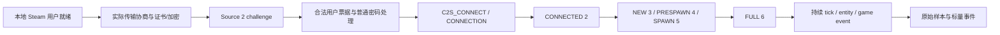

# 普通观众路线与最短验证设计

## 当前边界

2026-10-18 北京时间的用户实测：官方 CS2 `1.41.9.1/14191 10924 secure public`、Steam build `25966348`、SourceRevision `11133601` 普通客户端可观战，看到热身推进、玩家视角和雷达；没有 status/condump 原始输出，也没有正式回合事件证明。dedicated 已加载地图、匿名 Steam 身份 AuthStatus OK，`tv_relay` 经 challenge/connect/connection 后在 sign-on 2 被 `NETWORK_DISCONNECT_BADRELAYPASSWORD (2033)` 拒绝，普通观战密码重试相同。平台没有可提供的中继授权。

因此停止该源的 relay 路线，身份未就绪已不是这个失败的解释。此结论不推广其他源；云端未连接旧地址或任何生产比赛。公开 schema 的 disconnect 枚举值 33 与传输关闭码 2033 不处于同一编号层，原始数值分层保存，不能自行改写为同一个字段。

## 最短路线与停止条件

1. **先用官方普通客户端建立基准。** 用户本地登录 Steam，以当前有效普通观战授权接入一个独立测试源，保存版本、连接状态和连续 60 秒的推进证据。补采 status 及连接/断开时间；缺少状态日志时不能补写 FULL。
2. **立即验证合法数据出口。** 普通客户端执行正常 `record`，检查文件是否在观战期间增长并被原型解出新 tick/事件。官方命令转储将 record 标为 cheat，二进制也有本地客户端及录制资格检查，因此这一步完全可能被拒绝。被拒绝就保存原文，停止该出口；不启用 sv_cheats、不改标志、不调用隐藏命令绕过。不预先花时间压低 GPU 或做界面。
3. **出口可用后再测资源与两个消费时间。** 对照正常窗口与低画质/小窗口/适度限帧、最小化，各测数据新鲜度及 CPU/GPU/内存。降负载可能改变处理频率；只有实际数据证明才可采用。仍然是官方完整客户端，不能称为无渲染实现。
4. **出口不可用时，继续正常身份协议研究。** 本机短时抓包与静态代码交叉确认实际直连/SDR、协议版本、外层握手和失败位置。先获得官方支持的用户身份/证书/票据获取方法，再实现收发状态机。不能将 SteamKit 登录、匿名服务端票据、Web API key、删除 `is_hltv` 或复用 demo parser 视为已经满足该条件。

选择这条顺序是因为普通客户端已被用户验证可进入，而从零实现专有客户端还缺多项握手契约。当前也未证明官方低开销**无画面**模式能保持普通观众身份和持续输出。只有导入字符串 `Plat_EnableHeadlessMode`，不能证明 `-nullrhi` 可用；本分支不提供未经验证的启动参数或二进制补丁。官方 record 路线仅为取证过渡，不替代最终无画面目标，也不是继续云端协议研发的前置条件。

## 分层状态机：设计，不是已实现的连接器

具体传输封装、回调和消息先后仍要用当前普通客户端确认，图不是保证所有源一致的逐包时序。终止/超时任何阶段都不能升级后续阶段。sign-on 2 只说明 CONNECTED；FULL 本身还不证明持续数据或正式回合。

| 层                   | 已知证据                                                                                                                                              | 仍缺的可执行契约                                                                                                                                                    |
| -------------------- | ----------------------------------------------------------------------------------------------------------------------------------------------------- | ------------------------------------------------------------------------------------------------------------------------------------------------------------------- |
| Steam 用户身份       | 官方 GetAuthSessionTicket 文档；engine2 的 SteamInternal_ContextInit 和用户票据路径                                                                   | 自有轻客户端如何合法初始化 App 730 所需用户上下文、目标身份绑定、异步票据结果、有效期/取消及 GNS 证书；不得假设复制现成票据可重用                                   |
| GNS 传输             | 开源 GNS 的连接控制包、证书/crypt、可靠传输和加密机制                                                                                                 | 当前源实际使用直连还是 SDR、商业 Steam 后端接入条件、当前构建兼容性；外层握手成功不能替代 Source 2 接纳                                                             |
| 普通观众 connect     | 当前 protobuf 含 host_version/auth_protocol/challenge/encrypted_password/auth_steam/splitplayers；二进制看到 challenge 相关密码处理和 Steam auth 分支 | 密码变换与所有外围封装的已验证实现、普通身份标记/能力、当前 auth payload 格式、服务器授权接受；第二轮仅实现内存 payload/内层封装，见 HANDSHAKE-EVIDENCE；未发送连接 |
| sign-on / netchannel | 公开 0..7 状态枚举及消息定义；serverinfo、serializer、stringtable 等 schema                                                                           | 可靠消息序号/ACK、分片/重组/压缩、初始化依赖和客户端回应；收到 FULL 后能持续处理 delta 的状态机                                                                     |
| decode               | cs2parser 2.7.2 能解 Source 2 Demo；独立 demoparser2 作为 oracle                                                                                      | live netchannel 转为相同语义的边界及完整基线；Demo 外壳不等于在线协议                                                                                               |
| 比赛事件             | 本分支输出四类事件和 cursor                                                                                                                           | 授权源实录的连续性、正式阶段与身份可用性；taser 和显示同步实证                                                                                                      |

官方 Steamworks 文档要求游戏身份票据由对端验证，并等待相应获取结果；这不同于 WebAPI/OpenID 登录。静态分析支持官方客户端使用 Steam 用户上下文，但**未证明所有可行的第三方实现都必须同时运行官方 Steam GUI，也未证明可脱离它合法工作**。下一次基准测试使用官方 Steam 客户端；独立实现保留该阻塞，不伪造身份、不关闭安全性。

## 开源能力核对

- [Valve GameNetworkingSockets](https://github.com/ValveSoftware/GameNetworkingSockets)：传输实现，不含游戏实体、delta、压缩和 CS2 普通观众逻辑；开源版不等于 Steam 身份/SDR 服务。可用于理解控制包，不直接构成 secure CS2 客户端。
- [SteamKit](https://github.com/SteamRE/SteamKit)：Steam CM/账号协议库，不是 CS2 GOTV/sign-on 客户端；与获取受服务器接受的游戏会话认证仍有距离。
- [demoinfocs-golang broadcasts](https://github.com/markus-wa/demoinfocs-golang/tree/master/examples/broadcasts)：示例是 HTTP CSTV+ 的 sync/start/full/delta 发布端，需要提供方已开放对应 HTTP 接口。普通 GOTV IP:port 和观战密码不能推出 HTTP 出口存在。
- [cs2parser](https://github.com/osztenkurden/cs2parser)、[demoparser](https://github.com/LaihoE/demoparser)：Source 2 录像语义解码；本次实际复用的是本地文件能力。旧 Source 1 HLTV/Source SDK 实现可帮助认识概念，但没有当前 CS2 secure 普通观众的兼容证明。本次未找到并验证可直接复用的成熟完整客户端，不将“未找到”写成“不存在”。

公开协议来源固定到 [GameTracking-CS2 5ab573f](https://github.com/SteamTracking/GameTracking-CS2/tree/5ab573fa8afb5b8db98869d79ed79399fca6e747/Protobufs)，这是社区从已发布游戏提取的 schema，不是 Valve 承诺兼容的客户端 SDK。身份规则参考 [Steamworks authentication](https://partner.steamgames.com/doc/features/auth) 与 [ISteamUser](https://partner.steamgames.com/doc/api/ISteamUser#GetAuthSessionTicket)。

## 同一接收器的两个消费时间

目标仍是无渲染接收器同时服务：①允许范围内更早取得的事件用于镜头/预测；②与播出画面对应的狙击枪、taser 等事件特效。接收器必须遵守源端延迟，不存在通过本方案“获取未来”或越过服务端限制的承诺。

优先一个接收实例、一次解码、两个消费游标。只有实测证明两个授权源/不同延迟确有必要才考虑第二连接。当前先保存 `streamInstance + sequence + tick + tickInterval + observedAt + observedMonotonicMs`；未来同一源的原始记录可供两个游标读取。文件切换、重连、换图都创建新流并清空跨流关联。

120 秒只是可调整的预设假设，不代表提前量或平台固定延迟。源 tick 时间、接收墙钟、画面播放时间必须分开；现在 `displayTime=null`、`displayBinding=unverified`，未实现缓冲调度、复杂对时或特效引擎。当前 prototype 不含镜头目标所需位置/视角状态，后续在持续收数证明后扩展。武器事件只是为两种消费者保留最小可验证入口。

## 第三轮实现进展

[密码/SDK](PASSWORD-EVIDENCE.md) 与 [通道](CHANNEL-EVIDENCE.md) 已将部分静态未知转成可审查代码：密码变换、SDK 回调/清理、消息位编码、tag 1..4 和有界 LZ4。静态证据未齐的初始化与序号调度，和真实 App 730 上下文/参考流的外部条件分开记录；两者都不能由单纯 record 采样替代。阶段验收仍按下面标准，离线通过不提升在线状态。

## 阶段验收

| 阶段                 | 通过所需证据                                                  | 本次状态                                               |
| -------------------- | ------------------------------------------------------------- | ------------------------------------------------------ |
| 普通观众握手         | 当前授权源、普通身份被接受、完整状态轨迹及版本                | 用户报告官方客户端可看；自有客户端未实现，原始状态待采 |
| 持续接收保存         | 至少 60 秒源 tick 前进，原始样本可重读，断开/边界可辨         | 仅真实录像人为增长测试；在线 INCONCLUSIVE              |
| 解码                 | 同一实录可重放，独立工具核对事件 tick/武器                    | 公开 Demo 离线通过；目标源待测                         |
| 最小比赛事件         | 正式 round_start/end、weapon_fire/death 证据，身份/缺字段明确 | 公开 Demo 已验证；完美正式回合和 taser 待测            |
| 两种消费时间与无画面 | 同源关联、画面对应事件、连续数据及资源实测                    | 未实施、未实测                                         |
