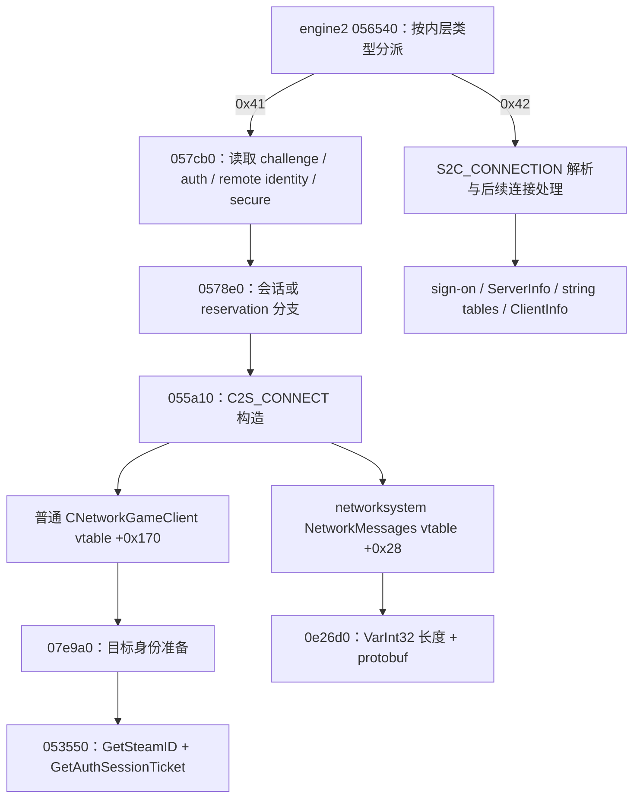

> 2026-10-19 已补齐服务器 auth=2 分支，当前实现与 ABI 2 说明见 [认证分支对照](AUTH-PROTOCOL-EVIDENCE.md)。下文保留此前 auth=3 阶段的取证记录。

# 第二轮：普通客户端握手的可实现边界

本轮继续推进最终的轻量无画面客户端，**没有把官方可渲染客户端 record → Demo 解析当作最终实现**。新增 `handshake.py` 是连接报文/票据生命周期/sign-on 的可独立测试部分，仍无 socket、Steam SDK 提供方、GNS 认证加密和完整 netchannel，不能接入完美。本轮没有用户登录、真实票据或真实普通观众流量。

后续第三轮已实现密码变换子集、可编译 SDK 桥和通道格式，见 [PASSWORD-EVIDENCE.md](PASSWORD-EVIDENCE.md) / [CHANNEL-EVIDENCE.md](CHANNEL-EVIDENCE.md)。下文保留第二轮取证时的边界，当前完整缺口以第三轮状态表为准。

## 二进制精确身份与版本解释

[二进制身份](evidence/binary-identity.json) 保存实际 Valve 内容下载文件的 SHA-256、PE COFF timestamp、机器类型及 RSDS 候选；它不声称做了 Authenticode 验证。

| 模块              | SHA-256                                                            | PE timestamp（UTC） | RSDS GUID / age                             |
| ----------------- | ------------------------------------------------------------------ | ------------------- | ------------------------------------------- |
| engine2.dll       | `6456df18d8f954394024c2c07da8c848df15a5ace74ce7390d78970ceb39ee21` | 2026-10-14 18:43:31 | `fcc665e0-6e57-43ea-872e-19951a118605` / 17 |
| networksystem.dll | `be7e13ad771b21c986e25d9469993a1225be5649473f3d722ca5eefe375d1bec` | 2026-10-14 18:38:41 | `7593b982-a75f-4dd0-bb30-feb3373b655a` / 9  |
| cs2.exe           | `8614097aaa2761b0a7157c0045861713e769fb1e8235f50fc68f411294dd60cf` | 2026-10-14 18:37:32 | `91f6ea07-cfe7-4557-aa46-926707d81a22` / 4  |

下载身份仍为 app 730、depot 2347771、manifest `8766757721818354077`。PE timestamp 是文件字段，不是可信发布时间证明。地址使用各模块 image base `0x180000000`，两个 DLL 地址不可混用。

GameTracking 固定快照中的 steam.inf：PatchVersion `1.41.9.1`、ClientVersion/ServerVersion `2000933`、SourceRevision `11133601`、VersionDate `Oct 15 2026`、VersionTime `10:15:52`。这与用户报告的一部分版本字段一致，但不是同一文件 hash 的证明，不能把 `14191`、`2000933`、`10924`、Steam build `25966348` 互换。`engine2!0x180247420` 的静态路径会读取 steam.inf 的版本字段，因此没有用某个“字符串附近的整数”冒充用户本机版本。

`capture.py` 可在用户方便时一次性读取本机同名文件的 hash/RSDS/steam.inf；无需复制二进制。只有 engine2 hash 一致，本文 engine2 地址才直接适用。不同 hash 要重新定位，不能照搬地址或修改本机文件。

## 已恢复的调用路径

关键查询的参数、evidence_id、原始结果 SHA-256、提供方和局限保存在 [handshake-evidence-index.json](evidence/handshake-evidence-index.json)。完整反编译文本和游戏文件不进入 PR/Library 包。



图中的六位地址省略公共基址 `0x180000000`；H/I 属于 networksystem，其余属于 engine2。静态调用图证明代码关联，不能证明远端接纳。

| 部分               | 精确证据                                                                                                                                                                                                                             | 本轮实现 / 剩余边界                                                                                                                                                                                             |
| ------------------ | ------------------------------------------------------------------------------------------------------------------------------------------------------------------------------------------------------------------------------------ | --------------------------------------------------------------------------------------------------------------------------------------------------------------------------------------------------------------- |
| 普通客户端票据路径 | engine2 `0x180540bc8` 的 RTTI 是 `CNetworkGameClient`，slot `+0x170` → `0x18007e9a0`。`CNetworkGameClientBase`、`CHLTVClientState` 另有相同目标 slot                                                                                 | 普通客户端和 relay 共享票据 helper，不表示观战角色授权相同。见 [ticket-vtables.json](evidence/ticket-vtables.json)                                                                                              |
| challenge          | `0x180056540` 分派 type `0x41`；`0x180057cb0` 消费 uint32 challenge、uint32 auth，auth=3 分支消费 uint16 key_size（必须 0）、uint64 remote identity、uint8 secure，再读取上下文字符串                                                | `parse_challenge_body` 实现静态支持的 auth=3 子集；输入是已合法解密并去掉 type 的内层 body。字符串终止/额外尾部仍待真实流验证；其他格式拒绝                                                                     |
| connect 字段来源   | `0x1800578e0` 将已存 challenge/auth/remote identity/secure 传入 `0x180055a10`；后者使用当前版本 getter、普通密码配置、splitplayer 名称、上下文、reservation 和票据                                                                   | `connect_payload` 只构造公开 protobuf。版本和 reservation 必须由调用者提供实际值，不猜固定版本、不伪造 reservation；`is_hltv` 不在此消息中                                                                      |
| 密码               | `0x180055a10` 使用 challenge 相关变换，输出 96 字节；没有在本轮实现/验证该变换算法                                                                                                                                                   | 要求已正确变换的 96 字节输入；仅源确实无密码时才允许 None。不能把明文密码、空值或移除 relay flag 当实现                                                                                                         |
| 用户票据           | `0x18007e9a0` → `0x180053550`；后者先写自身 GetSteamID 的 uint64，再在其后写 SDK ticket，返回长度加 8；最大本地 auth 缓冲 2048                                                                                                       | `TicketLease.auth_steam` 实现此前缀。它只消费外部合法 SDK 结果，不生成票据、不导入匿名服务端票据、不证明服务端授权                                                                                              |
| C2S 内层封装       | engine2 `0x180055a10` 写 `ffffffff` / `6b`，调用 NetworkMessages slot `+0x28`。networksystem 构造器 `0x1800ddc30` 给该对象安装 vtable `0x180239a28`，`+0x28` → `0x1800e26d0`；后者调用 `0x1801c0760` 写 VarInt32 长度，再写 protobuf | `connect_inner_message` 实现这个内层格式，限制在实际栈 writer 的 1200 字节预算；不是 UDP/GNS 包。schema 的 2400 上限不能代替较小的 writer 预算                                                                  |
| S2C 内层封装       | engine2 `0x1800a5430` 写 `ffffffff` / `42` 和相同长度封装，并用 ASCII `0` 补至至少 16 字节，writer 为 256 字节。客户端 `0x180056540` 调用 networksystem `+0x20` → `0x1800e20d0` 读取长度/protobuf                                    | `parse_connection_inner` 按此静态格式检查 body 与 padding；不会把 padding 当 protobuf，也不把解析成功当认证成功                                                                                                 |
| 普通 net message   | networksystem `0x1800e23d0` 写 UBitVar message id，再调用 `0x1800e26d0`；id 7 使用 6 bit 短形式，后续长度/字节不强制按字节对齐                                                                                                       | `signon_message_bits` 返回 data 与精确 bit_count。没有实现 netchannel 头、可靠序号、分片、ACK、压缩或 GNS 包装，不能将末字节补位当另一个消息                                                                    |
| sign-on 检查       | engine2 `0x18007e800` 在普通网络路径检查状态范围、前进关系和 spawn count；含 replay/local 特例，本研究不启用这些特例                                                                                                                 | `SignonSequence` 只跟踪普通路径子集；spawn count 不符拒绝，换图要求新实例，FULL 仍 INCONCLUSIVE                                                                                                                 |
| sign-on 应答       | `0x180060310` 将状态应答入队；`0x18005efa0` 填 signon_state、spawn_count、num_server_players=0；公开 message id 为 7                                                                                                                 | `signon_payload` 提供消息体。NEW/SPAWN 一旦触发尚未实现的初始化，后续状态也不能跳过此门禁来发 ACK                                                                                                               |
| NEW 初始化         | `0x180061460` 先安装/调用字符串表回调，再 `0x18005ff20` 发送 ClientInfo，然后发送 NEW 应答                                                                                                                                           | ClientInfo 需要当前 server_count、用户 account id；无匹配缓存使用零 CRC 请求完整表，见 [初始化对照](INITIALIZATION-EVIDENCE.md)；普通分支 is_hltv false 的观察不能替代完整角色/权限处理。未实现这组初始化副作用 |
| ServerInfo / SPAWN | `0x18006a280` → `0x180084810`：ServerInfo、session manifest、编码配置与世界尺度处理；`0x180060310` 存在延后 SPAWN 应答的分支                                                                                                         | 需要初始化实体 serializer/string table/基线及地图相关数据，具体完成条件仍缺。无画面实现应实现这些必要数据依赖，而不是假报“地图已加载”                                                                           |

尤其注意：早期 Ghidra 在 `0x18007e9a0` 将 helper 参数推断得过少；本轮对照调用点 `0x18007ec1d..0x18007ec46` 的寄存器/栈参数及 `0x180053550` 本体，确认实际多参数路径。伪代码的参数数量和“不可达块”警告不能直接作为 ABI 规范。

## Steam SDK 回调：官方契约与二进制观察分开

官方 [GetAuthSessionTicket](https://partner.steamgames.com/doc/api/ISteamUser#GetAuthSessionTicket)、[身份认证](https://partner.steamgames.com/doc/features/auth)、[RunCallbacks](https://partner.steamgames.com/doc/api/steam_api#SteamAPI_RunCallbacks) 提供用户票据、回调泵和取消接口。另核对 Valve 官方 [Proton 的 SDK 1.65 头文件](https://github.com/ValveSoftware/Proton/blob/bc896217ffcd67f892f952b010f898fe7bd0f0a1/lsteamclient/steamworks_sdk_165/isteamuser.h)：`SteamUser023`；虚表槽 `0x10` GetSteamID、`0x68` GetAuthSessionTicket、`0x88` CancelAuthTicket 与上述调用相符。GetAuthSessionTicketResponse_t 的字段是 ticket handle / EResult，callback id=163；Web API ticket 不是这个接口。

`TicketLease` 在外部 SDK 回调 handle 匹配且 EResultOK 后才放出票据 bytes，失败或断开/超时由宿主调用 close → CancelAuthTicket。它不会记录 bytes；清空其 bytearray 不代表抹除了 Python/SDK/调用者的所有副本。远端 SteamID 只有来自可信第三方或已认证 GNS 身份时才能作绑定依据，否则按 SDK 的 IP 绑定方式处理，不能信任任意 challenge 自报身份。

在已查到的 engine2 注册点，发现的是其他 Steam callback；**尚未定位当前官方客户端如何调度 id 163，也没有证明其发送前等待策略与这个保守组件完全相同**。本轮没有把 callback 注册示例当作已完成的 App 730 原生 SDK 初始化器。自己的正常用户身份、App 730 权限、证书及 secure 服务器的接受仍要由合法本地 SDK/平台集成验证。

## 实现和验证层次

`handshake.py` 是纯内存组件，不提供接收明文密码、票据文件或打印连接 bytes 的 CLI。12 个 `test_*.py` 测试使用明确的假凭据字节做格式/回调边界断言，不能运行于真实服务器。测试包含字面量封装、长度越界、challenge 格式、ticket callback 错 handle/失败/取消、sign-on spawn count 和不可跳过的初始化门禁；无模拟流被标为在线成功。

当前可以继续集成的具体部件是：合法 GNS 提供方返回内层消息后，调用 challenge parser；合法用户 SDK 结果完成回调门禁后拼认证字段；密码变换提供方与配置给出实际参数后构造 connect；解密后的 S2C_CONNECTION 按长度/padding 解析；之后用 sign-on 跟踪器拒绝乱序/错误计数。**这些组件并未组合成可运行在线客户端。**

剩余核心缺口包括：App 730 用户 SDK/GNS 的合法初始化与证书获取；密码变换的互操作验证；netchannel 可靠传输/压缩/分片；ServerInfo 编码配置、serializer、string table、实体基线及初始化应答；无渲染情况下如何完成必要状态。静态研究仍可继续缩小这些范围，但本轮没有可认证的普通观众参考会话，不能证明它们的组合正确。record 实测只解决官方数据出口与样本来源，**不能解决以上自有客户端缺口**。

## 可重放取证

`rea_session.py` 只允许静态查询，按 recipe 强制核对二进制 hash，使用任务内 REA/Ghidra/JDK；不注册全局 MCP、不启动游戏、不上传任何文件。原始反编译结果保存在新建私有目录；可交付索引只留查询参数、证据标识和 hash。

```bash
python apps/companion/research/ordinary-gotv/rea_session.py \
  --rea /workspace/gotv-research/rea/node_modules/.bin/rea \
  --ghidra /workspace/gotv-research/tools/ghidra_12.1.4_PUBLIC \
  --jdk /workspace/gotv-research/tools/jdk/jdk-21.0.12.1+1 \
  --binary /workspace/gotv-research/cs2/game/bin/win64/networksystem.dll \
  --queries apps/companion/research/ordinary-gotv/evidence/networksystem-queries.json \
  --output /workspace/gotv-research/new-private-network-analysis
```

engine2 换成对应文件与 `engine2-queries.json`。二进制不同就拒绝重放；重新下载的新版本不得冒充本轮精确目标。

本轮已使用此脚本实际重放 networksystem 的 5 个静态查询，全部成功；[实际运行索引](evidence/rea-reproduction.json) 保留每次结果 hash 和 evidence_id。该运行未启动游戏、未发送网络握手。

